<!-- ═══════════════════════════ HERO ═══════════════════════════ -->


 

 

<!-- ═══════════════════════════ 01 ABOUT ═══════════════════════════ -->
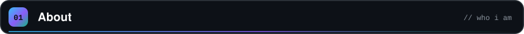

 

### Frontend Engineer — React · Next.js · TypeScript

I build responsive, accessible, and high-performance web applications with clean component architecture and strict type safety. 
Experienced in shipping production platforms including institutional career portals, booking engines, and B2B marketplaces. 
Backed by strong computer science and systems foundations (C, algorithms, memory management, Unix) honed through **School 21 (42 Network)**.

⚡ High Performance &nbsp;·&nbsp; 🧩 Scalable Architecture &nbsp;·&nbsp; 🛡️ Strict Type-Safety &nbsp;·&nbsp; 🎯 Core Web Vitals (95+)

 

<!-- ═══════════════════════════ 02 SKILLS ═══════════════════════════ -->
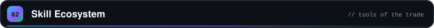

 

  

  

  

  

  

  

  
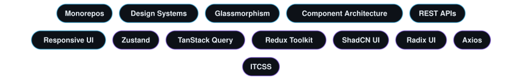

 

<!-- ═══════════════════════════ 03 METRICS ═══════════════════════════ -->
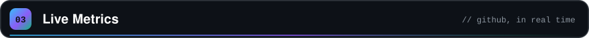

 

  

<picture>
  <source media="(prefers-color-scheme: dark)" srcset="https://raw.githubusercontent.com/thefarrukhdev/thefarrukhdev/output/github-contribution-grid-snake-dark.svg" />
  <source media="(prefers-color-scheme: light)" srcset="https://raw.githubusercontent.com/thefarrukhdev/thefarrukhdev/output/github-contribution-grid-snake.svg" />
  
</picture>

 

<!-- ═══════════════════════════ 04 PROJECTS ═══════════════════════════ -->
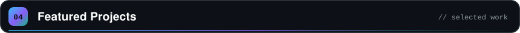

 

<a href="https://safaar.uz">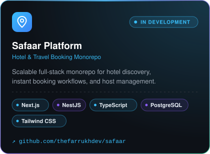</a>
<a href="https://careerhub.21-school.uz">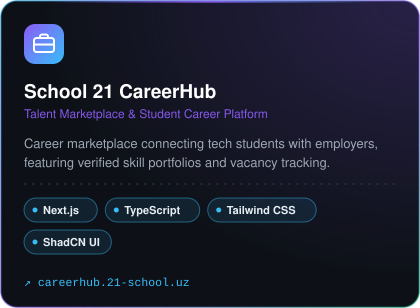</a>

<a href="https://bunkerstroy.uz">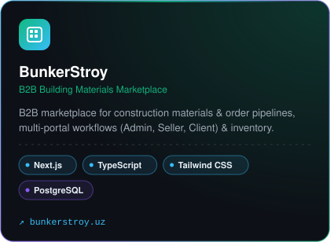</a>
<a href="https://kualumni.uz">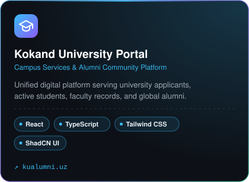</a>

<a href="https://github.com/thefarrukhdev/agychat">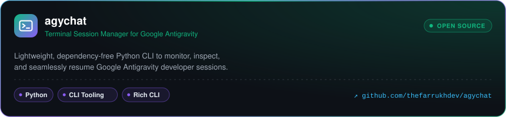</a>

 

| Project | Description | Stack | Links |
| :--- | :--- | :--- | :--- |
| **School 21 CareerHub** | Institutional talent marketplace connecting 500+ tech engineers with employers | `Next.js 15` · `TypeScript` · `Tailwind CSS` · `shadcn/ui` | [Live](https://careerhub.21-school.uz) |
| **Safaar Platform** | Hotel accommodation & reservation monorepo | `Next.js 15` · `NestJS` · `TypeScript` · `PostgreSQL` | [Live](https://safaar.uz) · [Code](https://github.com/thefarrukhdev/safaar) |
| **BunkerStroy Marketplace** | B2B construction materials & multi-portal logistics platform | `Next.js` · `Node.js` · `TypeScript` · `PostgreSQL` | [Live](https://bunkerstroy.uz) · [Code](https://github.com/thefarrukhdev/bunkerstroy) |
| **Kokand University Portal** | Academic analytics and graduate vacancy hub | `React` · `TypeScript` · `Tailwind CSS` · `REST APIs` | [Live](https://kualumni.uz) · [Code](https://github.com/thefarrukhdev/kokand_university) |
| **agychat** | Lightweight CLI session manager for Google Antigravity | `Python` · `CLI Tooling` · `Rich` | [Code](https://github.com/thefarrukhdev/agychat) |

 

<!-- ═══════════════════════════ 05 CONNECT ═══════════════════════════ -->
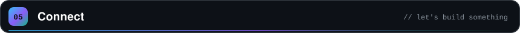

 

  

Built in Tashkent · shipped with React, Next.js & TypeScript.

